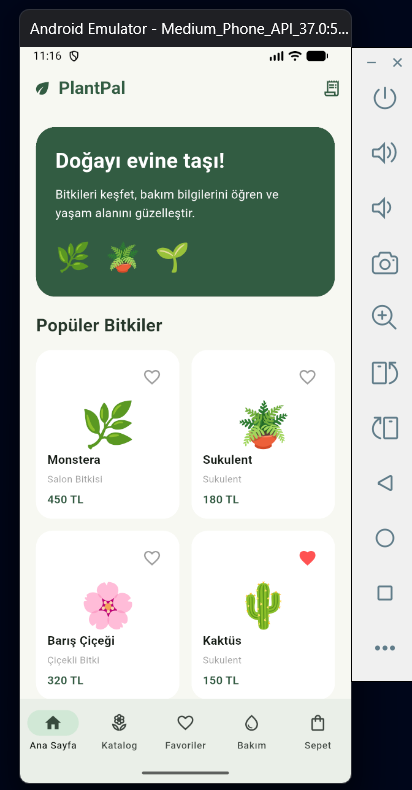
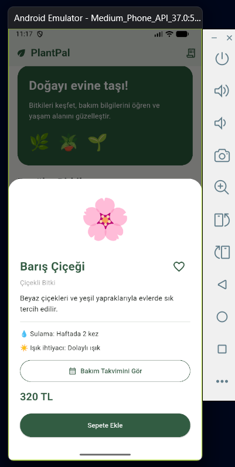
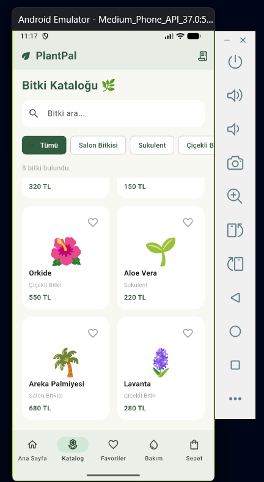
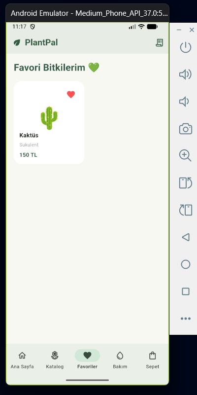
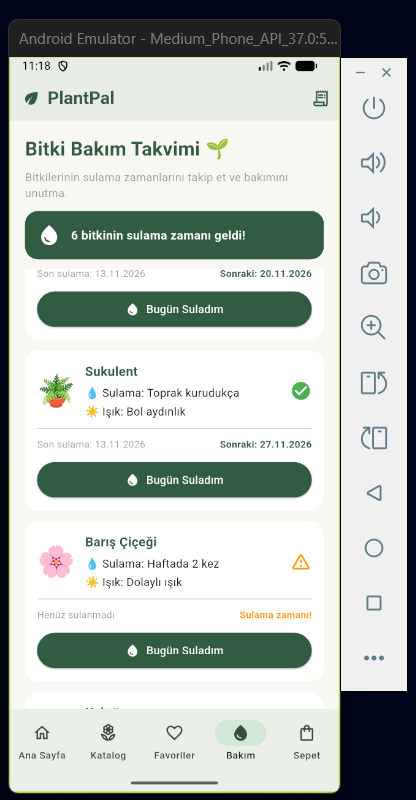
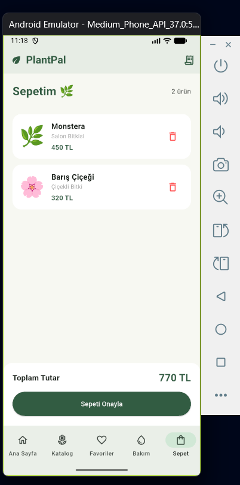
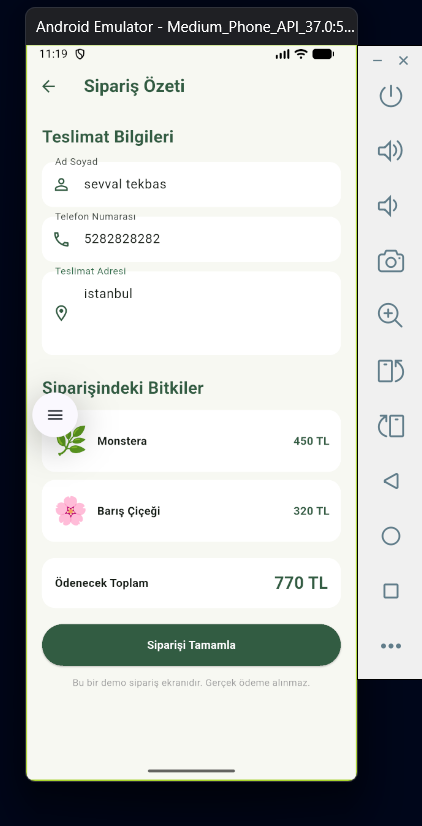
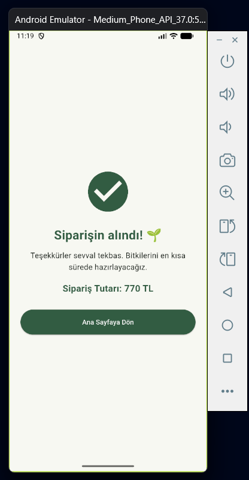

# 🌱 PlantPal – Bitki Bakım ve Yönetim Uygulaması

PlantPal, Flutter ve Dart kullanılarak geliştirilen, kullanıcıların bitkilerini keşfetmesini, bakım süreçlerini takip etmesini ve bitki alışverişi yapmasını sağlayan bir mobil uygulamadır.

## 🚀 Özellikler

- **Ana Sayfa:** Popüler bitkiler ve fiyat bilgileri.
- **Bitki Kataloğu:** Bitki listeleme, arama ve kategori filtreleme.
- **Bitki Detayları:** Bitkiler hakkında ayrıntılı bilgiler.
- **Favoriler:** Beğenilen bitkileri favorilere ekleme ve çıkarma.
- **Bakım Takvimi:** Sulama aralıklarını ve sonraki sulama tarihlerini takip etme.
- **Sulama Hatırlatıcıları:** Yerel bildirimlerle sulama zamanlarını hatırlatma.
- **Alışveriş Sepeti:** Ürün ekleme, çıkarma ve toplam tutarı hesaplama.
- **Sipariş İşlemleri:** Teslimat bilgileri, demo sipariş oluşturma ve sipariş geçmişi.

## 🪴 Kullanılan Teknolojiler

- Flutter
- Dart
- SharedPreferences
- flutter_local_notifications
- timezone
- flutter_timezone
- Android Studio Emulator
- Git & GitHub

## 🌿 Uygulamada Bulunan Bitkiler

| Bitki | Fiyat |
|---|---:|
| Monstera | 450 TL |
| Sukulent | 180 TL |
| Barış Çiçeği | 320 TL |
| Kaktüs | 150 TL |
| Orkide | 550 TL |
| Aloe Vera | 220 TL |
| Areka Palmiyesi | 680 TL |
| Lavanta | 280 TL |

## 💾 Veri Saklama

SharedPreferences kullanılarak favoriler, sepet ürünleri, sulama kayıtları ve sipariş geçmişi yerel olarak saklanmaktadır.

## 📱 Uygulama Ekran Görüntüleri

### 1. Ana Sayfa


### 2. Bitki Detay Ekranı


### 3. Bitki Kataloğu


### 4. Favoriler


### 5. Bitki Bakım Takvimi


### 6. Alışveriş Sepeti


### 7. Sipariş Özeti


### 8. Sipariş Başarı Ekranı


## 🧪 Test Durumu

- Flutter Analyze kontrolü başarıyla tamamlandı.
- Android emülatöründe uygulama çalıştırıldı.
- Favori, sepet ve sulama kayıtlarının kalıcılığı kontrol edildi.
- Sipariş süreci test edildi.
- Bildirim izni ve yapılandırması tamamlandı.

**Not:** Sulama bildirimlerinin planlanan zamanda gerçekten görüntülendiği henüz kesin olarak doğrulanmamıştır.

## 🔗 GitHub

Proje kaynak kodlarına aşağıdaki bağlantıdan ulaşabilirsiniz:

[PlantPal GitHub Repository](https://github.com/sevval230605/PlantPal)

---

**PlantPal – Bitkilerinize iyi bakmanın kolay yolu! 🌱**
## 💻 Kurulum ve Çalıştırma

**Gereksinimler**
- Flutter 3.47.9
- Dart 3.13.7
- Android Studio veya uyumlu bir Android cihaz/emülatör

**Kurulum**

Projeyi bilgisayarınıza indirin:

```bash
git clone https://github.com/sevval230605/PlantPal.git
```

Proje klasörüne girin:

```bash
cd PlantPal
```

Gerekli paketleri yükleyin:

```bash
flutter pub get
```

Uygulamayı çalıştırın:

```bash
flutter run
```